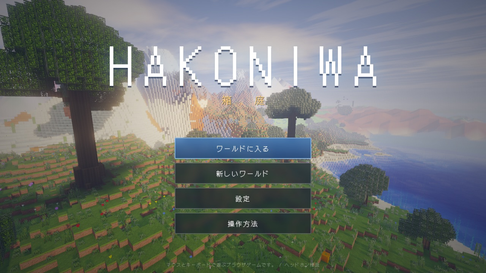
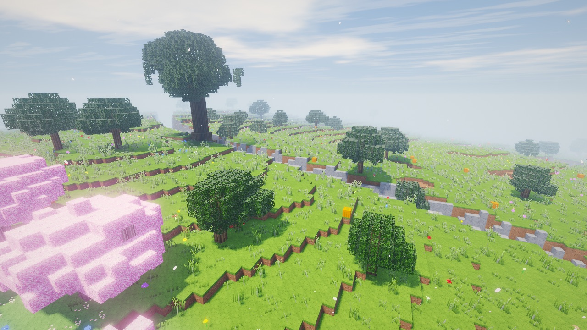
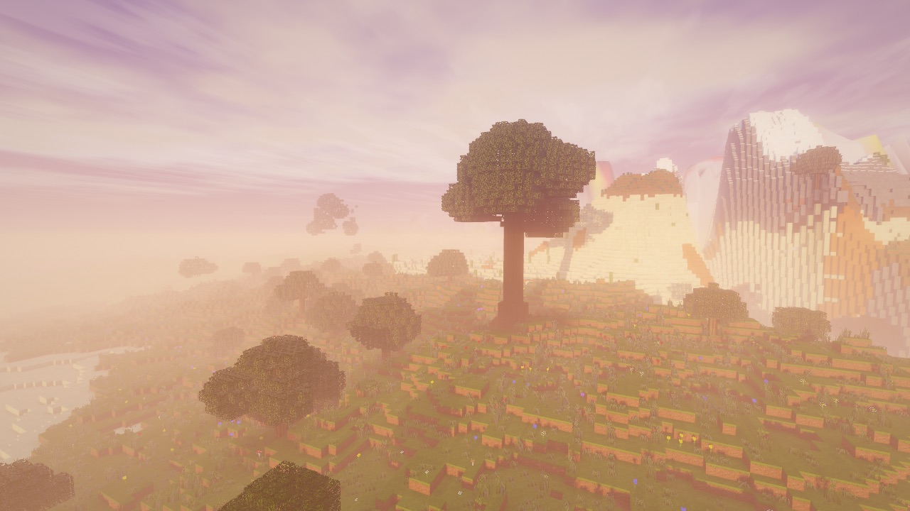
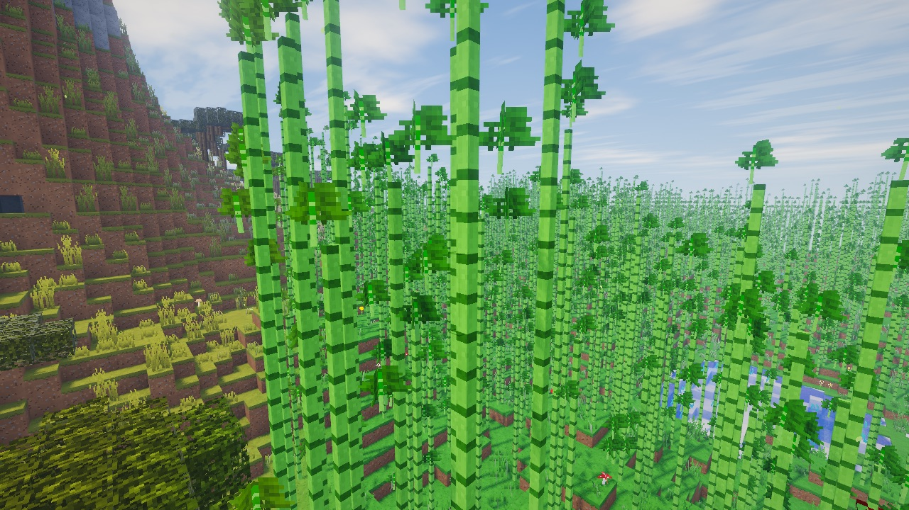
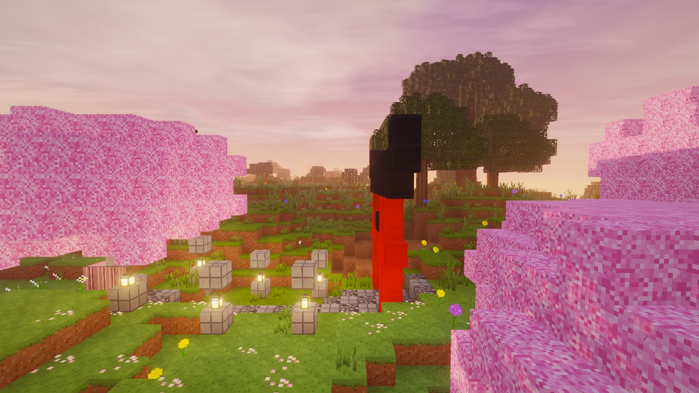
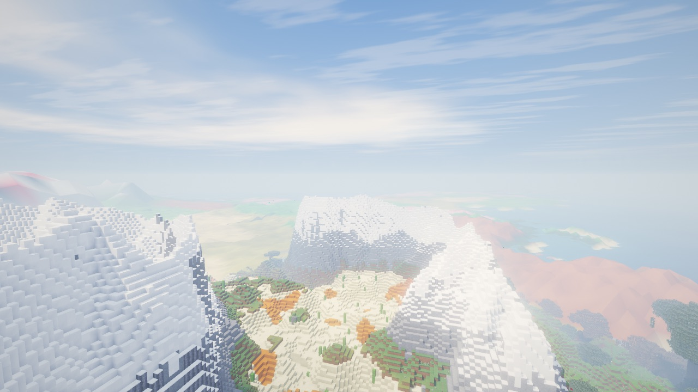
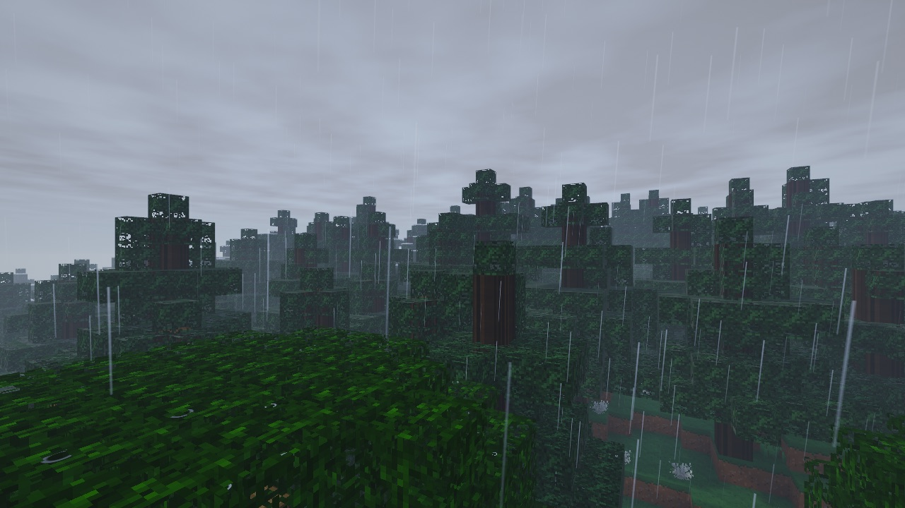
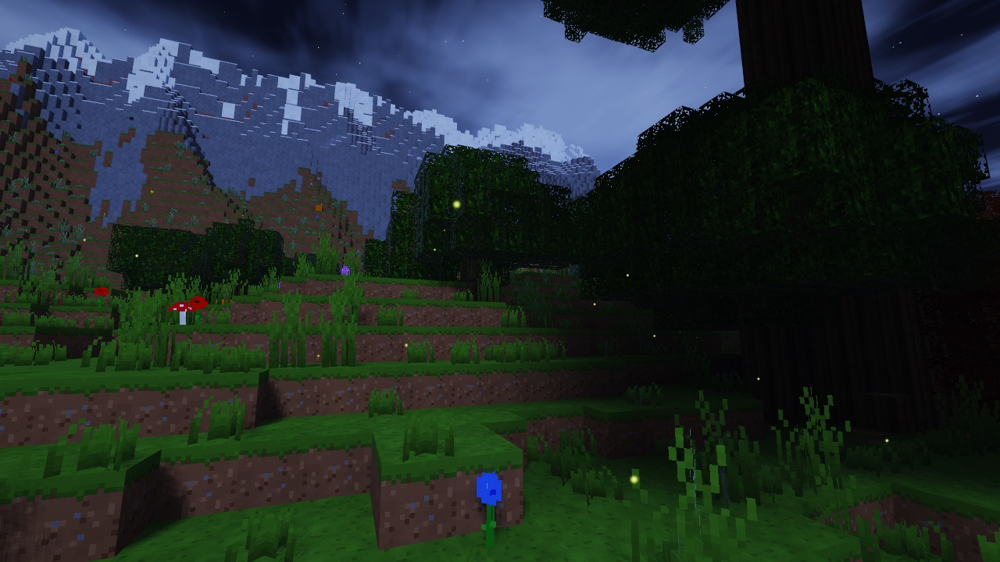
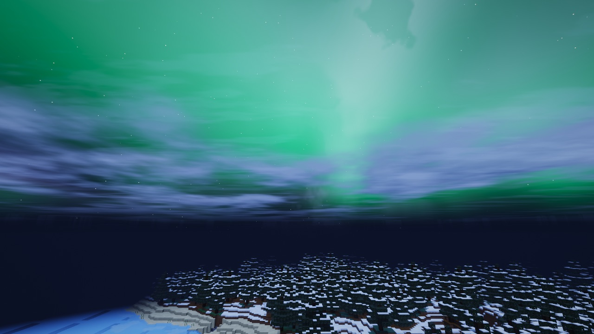

# HAKONIWA 箱庭

ブラウザで遊べる、**世界観にすべてをかけた**ボクセルワールド。
クラフトもモブもありません。歩いて、飛んで、置いて、壊して、ただ世界を眺めるための箱庭です。

- 操作はJava版マインクラフトと同じ（WASD・Space・Shift・Ctrl・クリック・ホットバー・E・F3・F5 …）
- 画像・音声の素材は**一切使っていません**。テクスチャも効果音もBGMも、すべてコードで生成しています
- Three.js + TypeScript + Vite。Vercel にそのままデプロイできます

<p align="center"></p>

| | |
|---|---|
|  |  |
|  |  |
|  |  |
|  |  |

## 世界

| | |
|---|---|
| 地形 | 大陸・海・川・山脈・洞窟・溶岩・鉱石。バイオーム境界で草や水の色がなめらかに変わります |
| バイオーム | 平原／花の草原／森／シラカバの森／紅葉の森／桜の丘／竹林／タイガ／雪原／砂漠／サバンナ／湿地／山岳／雪山／海／川／砂浜 |
| 建築 | ハーフブロックと階段（8素材）、朱塗り・黒漆・提灯・竹など、和の建材 |
| 構造物 | 参道と石灯籠を従えた鳥居、苔むした環状列石、まれに現れる巨木 |
| 時間 | 日の出・夕焼け・星空・天の川・月の満ち欠け（日ごとに変わる）・流れる雲と、その影 |
| 天気 | 雨・雷雨（稲光と雷鳴）・雪。寒い土地の夜にはオーロラ |
| 光 | 太陽/月の影、雲の影、木漏れ日、光芒、ブルーム、滑らかなライティングとAO、松明のゆらぎ |
| 水 | 水深で変わる色、岸辺の泡、空の映り込み、雨の波紋、水中の屈折 |
| 遠景 | 読み込み範囲の外も、霞の向こうに山並み・海・桜の丘のピンクが2km先まで続いて見えます |
| 空気感 | 舞い散る桜の花びらと紅葉、蛍、陽だまりの光の粒、風にそよぐ草木 |
| 音 | 足音（素材ごと）、風、雨、波、鳥、虫、フクロウ、洞窟のしずく、溶岩、雷、ピアノ風の生成BGM |

## 操作

| キー | 動作 |
|---|---|
| W A S D / マウス | 移動 / 視点 |
| Space | ジャンプ（2回押しで飛行の切替） |
| Shift | しゃがむ（縁から落ちない）／飛行中は下降 |
| Ctrl または W 2回 | ダッシュ |
| 左クリック | 壊す（長押しで連続） |
| 右クリック | 置く（長押しで連続） |
| 中クリック / Q | 見ているブロックを選ぶ |
| 1〜9 / ホイール | ホットバー |
| E | ブロック一覧（検索・カテゴリ。アイコンにカーソルを合わせて 1〜9 でスロットへ） |
| T / `/` | チャット・コマンド |
| F1 / F2 / F3 / F5 / F11 | HUD / スクリーンショット / デバッグ / 視点切替 / フルスクリーン |

### コマンド

```
/time set <day|noon|sunset|night|midnight|sunrise|数値>   /time add <n>
/weather <clear|rain|thunder>
/tp <x> <y> <z>        （~ で相対座標）
/locate <cherry|bamboo|autumn|desert|taiga|mountains|ocean …>   最寄りのバイオームを探す
/fly   /seed   /biome   /timespeed <n>   /aurora   /save   /clear   /help
```

建築物は IndexedDB に自動保存され、次回「続きから遊ぶ」で復元されます。

## 開発

```bash
npm install
npm run dev      # http://localhost:5173
npm run build    # dist/ に出力
npm run typecheck # 型チェック
npm run preview
```

`?seed=好きな文字列` を付けると、同じ世界を再現できます。

## Vercel にデプロイ

1. このリポジトリを GitHub に push
2. https://vercel.com/new でリポジトリを Import（設定の変更は不要。Vite が自動で検出されます）
3. Deploy

`vercel.json` で、ビルドコマンドと出力先、アセットの長期キャッシュを指定しています。

## 構成

```
src/
  worldgen.ts   地形・バイオーム・洞窟・植生・構造物の生成（シードから決定的）
  mesher.ts     チャンクのメッシュ化（頂点ごとの滑らかな光・AO・バイオーム着色）
  lighting.ts   スカイライト / ブロックライトの伝播
  worker.ts     生成とメッシュ化を担当する Web Worker（並列）
  world.ts      チャンクのストリーミング・ブロック操作
  player.ts     Java版と同じ 20TPS の物理（歩行・ダッシュ・水泳・飛行・段差・しゃがみ縁止め）
  render/       空・天候・影・水・ポストプロセスのシェーダー
  ambient.ts    雨・雪・花びら・蛍など GPU 駆動の環境演出
  audio.ts      WebAudio による手続き的な効果音・環境音・BGM
```
